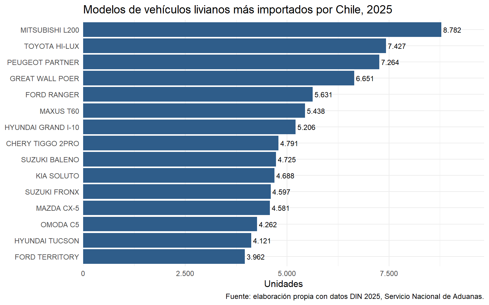
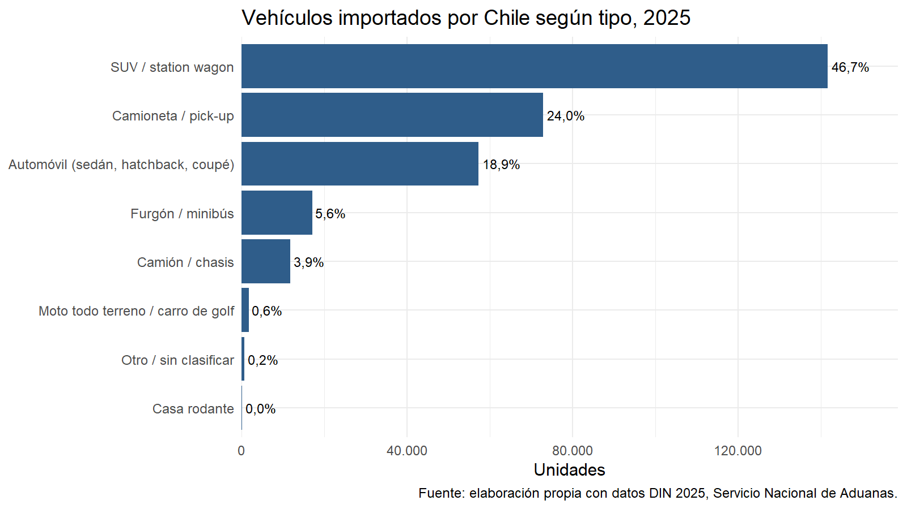
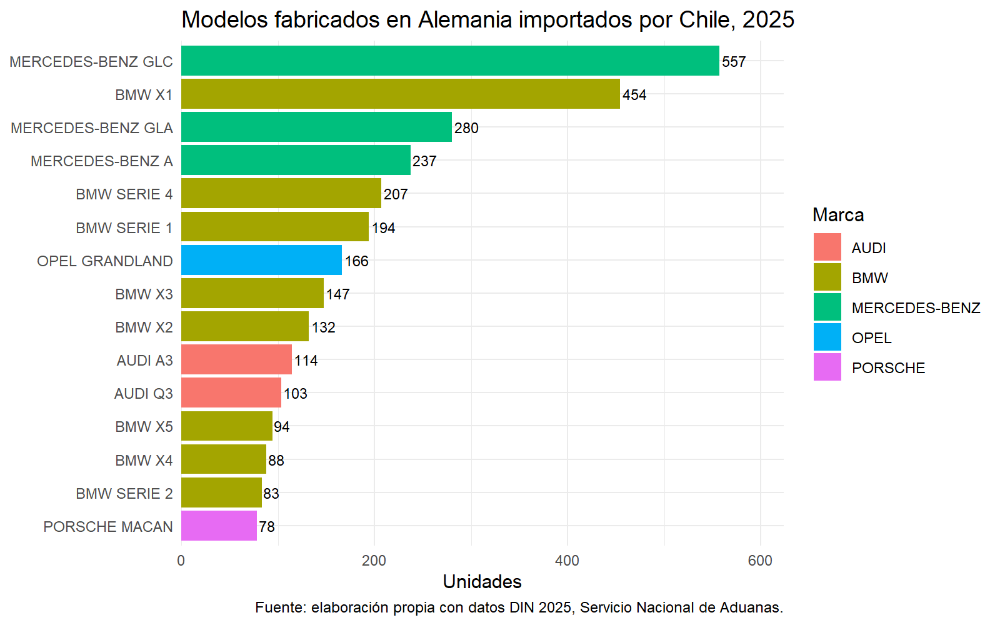
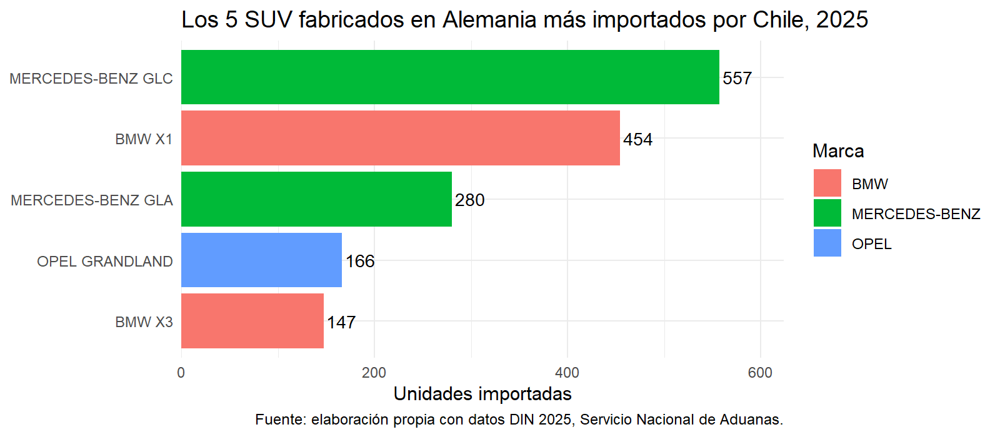
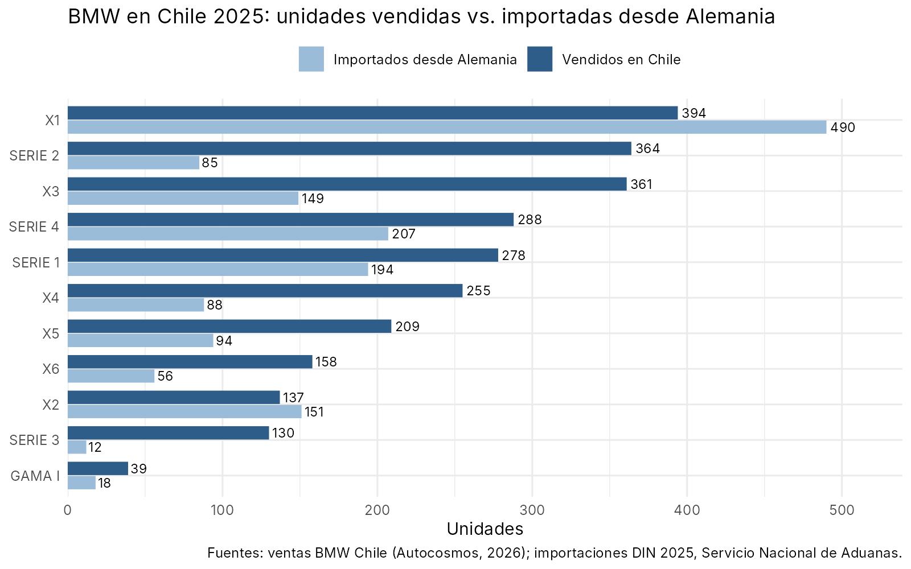

# Importación de vehículos desde Alemania hacia Ñuble – Estudio de mercado

**Comercio Exterior · Ingeniería Comercial · Universidad de Concepción, Campus Chillán · 2026**
Evaluación N°3 – Grupo 11: *Alemania · Carta de Crédito · Importación · Vehículos*
Integrantes: Javier Cáceres, José Muñoz, Cristóbal Sepúlveda

---

## ¿Qué hay en este repositorio?

Aquí está el **estudio de mercado** de nuestro trabajo. Usamos **datos reales de importación del año 2025** publicados por el Servicio Nacional de Aduanas para responder estas preguntas:

1. ¿Qué **modelos de vehículos** llegaron más a Chile en 2025?
2. ¿Qué **tipos de vehículo** (SUV, camioneta, automóvil, etc.) se importan más?
3. ¿Qué modelos se **fabricaron en Alemania** y llegaron a Chile?
4. ¿Cuáles son los **5 SUV alemanes** más importados?
5. ¿Lo que se importa se parece a lo que **realmente se vende**?

Con esas respuestas elegimos el vehículo que importa nuestra empresa y justificamos una cantidad y un precio realistas.

---

## Principales resultados

### 1. Los modelos más importados por Chile en 2025

Las **camionetas** encabezan la lista: Mitsubishi L200 (8.782 unidades), Toyota Hilux (7.427) y Peugeot Partner (7.264). Después vienen la GWM Poer y la Ford Ranger.



### 2. Tipos de vehículo importados

Casi **la mitad de los vehículos que llegan a Chile son SUV (46,7%)**. Les siguen las camionetas (24,0%) y los automóviles (18,9%).



### 3. Vehículos fabricados en Alemania

En 2025 llegaron **4.133 vehículos livianos fabricados en Alemania**, el 1,4% del total. **BMW** (41%) y **Mercedes-Benz** (33%) concentran tres de cada cuatro. Los modelos más importados son el **Mercedes-Benz GLC (557)** y el **BMW X1 (454)**, ambos SUV.



| Modelo (origen Alemania) | Unidades 2025 | Precio FOB promedio (US$) | Precio CIF promedio (US$) |
|---|---:|---:|---:|
| Mercedes-Benz GLC | 557 | 41.949 | 43.008 |
| BMW X1 | 454 | 31.896 | 32.426 |
| Mercedes-Benz GLA | 280 | 30.188 | 31.227 |
| Mercedes-Benz Clase A | 237 | 26.553 | 27.498 |
| BMW Serie 4 | 207 | 36.989 | 37.578 |

*FOB = precio del auto puesto en el barco en Alemania. CIF = FOB + flete + seguro hasta Chile.*

### 4. Los 5 SUV fabricados en Alemania más importados

Como nuestra empresa se enfoca en **SUV** (el 59% de los autos nuevos vendidos en Ñuble en 2025), filtramos solo este tipo de vehículo:

| # | SUV (versión más importada) | Motor | Unidades 2025 | Código arancelario |
|---|---|---|---:|---|
| 1 | Mercedes-Benz GLC 220d 4MATIC | Diésel 2.0 | 557 | 8703.32.91 |
| 2 | BMW X1 sDrive18i | Bencina 1.5 | 454 | 8703.22.91 |
| 3 | Mercedes-Benz GLA 200 | Bencina 1.3 | 280 | 8703.22.91 |
| 4 | Opel Grandland Hybrid | Híbrido (bencina) | 166 | 8703.40.24 |
| 5 | BMW X3 20 xDrive | Bencina 2.0 | 147 | 8703.23.91 |



### 5. ¿Lo importado se parece a lo vendido?

Los datos de Aduanas muestran lo que **entró** al país, no lo que se **vendió**. Como no hay estadísticas públicas de ventas para todos los modelos, comparamos con las ventas que publicó **BMW Chile** para 2025.

En los modelos que se fabrican en Alemania (X1, Serie 4, Serie 1, X2), las unidades importadas desde Alemania se parecen bastante a las vendidas. En cambio, en modelos como la Serie 2 o el X3 se vende mucho más de lo que llega desde Alemania, porque esos modelos se fabrican principalmente en otros países.

**Conclusión:** para los modelos fabricados en Alemania, las importaciones son una buena aproximación de las ventas.



Las tablas completas están en la carpeta [`output/tablas`](output/tablas).

---

## ¿De dónde salen los datos?

| Fuente | Qué contiene | Dónde encontrarla |
|---|---|---|
| **Servicio Nacional de Aduanas** – Registro de Importaciones 2025 | Todas las Declaraciones de Ingreso (DIN) del año: qué se importó, desde qué país, cuántas unidades, a qué precio, con qué flete y seguro | [datos.gob.cl – Servicio Nacional de Aduanas](https://datos.gob.cl/organization/servicio_nacional_de_aduanas) |
| **Aduanas** – Descripción y estructura de datos | El "diccionario" que explica qué significa cada columna | Misma página (archivo incluido en `data/raw/`) |
| **ANAC** – Informe Mercado Automotor diciembre 2025 | Ventas de autos nuevos en Chile por marca y por región (incluye Ñuble) | [anac.cl](https://www.anac.cl/wp-content/uploads/2026/01/12-ANAC-Mercado-Automotor-Diciembre-2025.pdf) |
| **Autocosmos** – "BMW Chile cierra el 2025 lleno de optimismo" (13-01-2026) | Ventas de BMW en Chile 2025 por modelo (archivo incluido en `data/raw/`) | [autocosmos.cl](https://noticias.autocosmos.cl/2026/01/13/bmw-chile-cierra-el-2025-lleno-de-optimismo) |

---

## ¿Cómo lo hicimos? (paso a paso)

**Paso 1 – Descargar.** Bajamos de datos.gob.cl los 12 archivos mensuales de importaciones de 2025 (enero a diciembre). Cada mes trae alrededor de 400.000 registros con **todo** lo que importó Chile: celulares, ropa, maquinaria, alimentos, vehículos, etc. En total son casi 5 millones de registros.

**Paso 2 – Quedarnos solo con los vehículos.** Cada producto importado tiene un **código arancelario** que dice qué es. Nos quedamos con dos:
- **8703**: automóviles y SUV.
- **8704**: camionetas, furgones y camiones.

Así pasamos de casi 5 millones de registros a unos 31.000.

**Paso 3 – Identificar el país de fabricación.** Cada registro indica el **país de origen**. El código de Alemania en Aduanas es el **563**. Con eso separamos los vehículos fabricados en Alemania.

**Paso 4 – Ordenar la información.** Cada importador escribe la descripción del vehículo a su manera (por ejemplo "MERCEDES BENZ", "MERCEDEZ" o "MERCEDES-BENZ"). Por eso unificamos los nombres de **marca**, **modelo** y **tipo de vehículo** (SUV, automóvil, camioneta, etc.).

**Paso 5 – Contar y graficar.** Sumamos las unidades importadas por modelo, por tipo y por país, calculamos los precios promedio y armamos los gráficos que se ven arriba.

**Paso 6 – Comparar con ventas reales.** Cruzamos las importaciones de BMW con las ventas que la marca informó para 2025, para comprobar si lo importado sirve como aproximación de lo vendido.

---

## Consideraciones

- **Un registro no es un auto.** Una misma declaración puede traer 1 o 300 vehículos del mismo modelo. Por eso contamos sumando la **cantidad** declarada, no el número de filas.
- **Errores de digitación.** Algunas declaraciones traen cantidades imposibles (por ejemplo, 600.000 unidades a US$ 1 cada una). Las dejamos fuera: solo consideramos vehículos con precio de al menos US$ 1.500.
- **Descripciones incompletas.** En un 1,8% de las unidades no fue posible identificar la marca. Quedaron como "sin identificar".
- **Origen ≠ marca.** Que una marca sea alemana no significa que el auto se fabrique en Alemania. Por ejemplo, casi todos los Volkswagen que llegan a Chile se fabrican en Brasil, Argentina o México. En este estudio contamos **el país donde se fabricó el vehículo**, no la nacionalidad de la marca.
- **Importaciones no son ventas.** Estos datos muestran lo que **entró** al país en 2025. Las ventas a clientes finales las publica ANAC.

---

## Organización de las carpetas

```
├── README.md                ← este documento
├── data/
│   ├── raw/                 ← datos originales, tal como se descargaron
│   │   ├── din_2025/        ← 12 archivos mensuales de Aduanas (.rar)
│   │   ├── descripcion-y-estructura-de-datos-.xlsx
│   │   └── ventas_bmw_chile_2025.csv   ← ventas BMW 2025 (Autocosmos)
│   └── processed/           ← datos ya filtrados (solo vehículos)
├── scripts/                 ← instrucciones que hacen el trabajo automáticamente
│   ├── 00_extraer_filtrar_din.py   ← pasos 1 a 3 (descomprimir y filtrar)
│   └── 01_ranking_vehiculos.R      ← pasos 4 a 6 (ordenar, contar, graficar, comparar)
└── output/
    ├── tablas/              ← resultados en formato Excel/CSV
    └── graficos/            ← gráficos usados en el informe y la presentación
```

## Para quien quiera reproducirlo

1. Descargar este repositorio (botón verde **Code → Download ZIP**).
2. Abrir `Comercio_Exterior.Rproj` en RStudio.
3. Abrir `scripts/01_ranking_vehiculos.R` y presionar **Source**.
   Las tablas y gráficos se generan solos en la carpeta `output/`.

*El script `00_extraer_filtrar_din.py` (Python) solo es necesario si se quiere volver a filtrar los archivos originales de Aduanas. Los datos filtrados ya están incluidos.*

---

**Herramientas:** R (dplyr, ggplot2), Python. El procesamiento de datos se realizó con apoyo de un asistente de IA (Claude); los resultados fueron revisados por el grupo.
